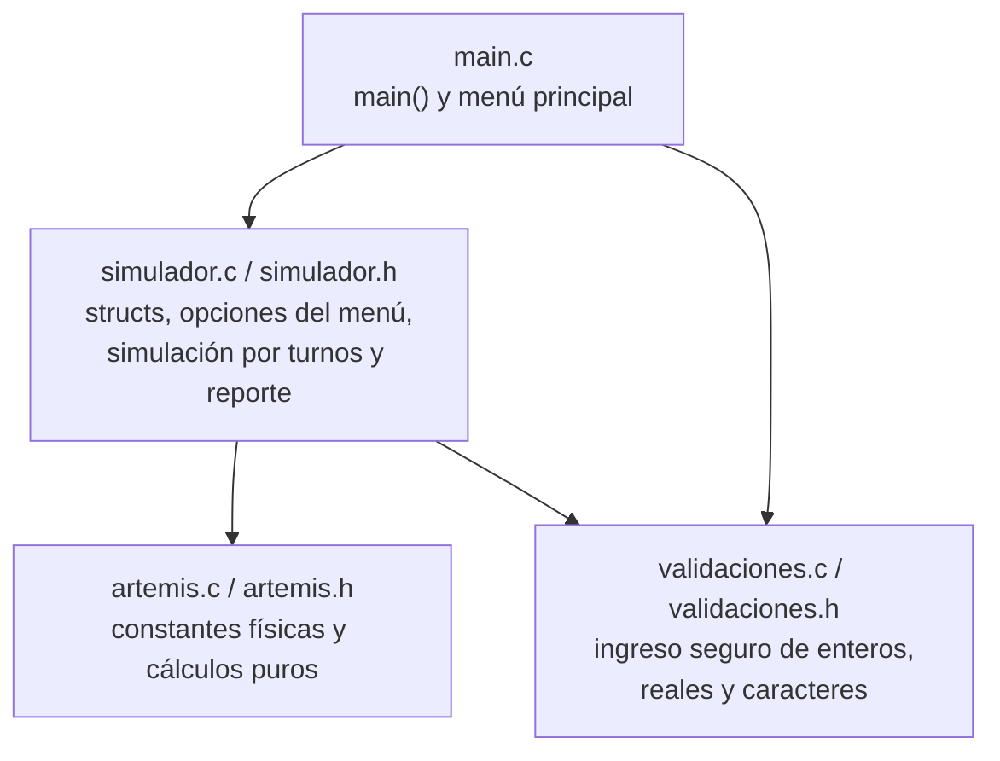
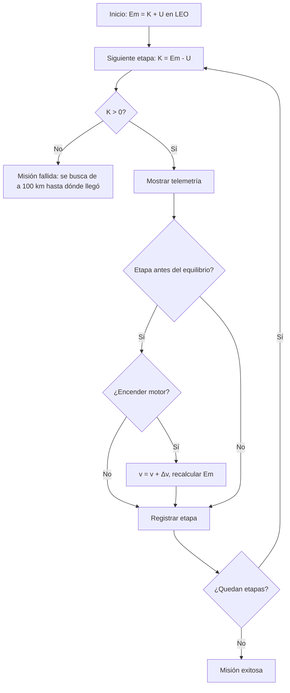

# Laboratorio de C — Simulador de Misiones Artemis (Escenario 3)

Repositorio del Trabajo Práctico Integrador Final del laboratorio de C de la materia **Algoritmos y Estructuras de Datos**, carrera de Ingeniería en Sistemas de Información, UTN FRRe.

## Integrantes

* Alvarez, Daniel Agustin
* Brailovsky Chas, Ramiro Iván
* Kohler, Sofía Pilar
* Meza, Leandro David
* Sanz, Victoria

*Año: 2026* — *Comisión K1.2*

---

## Escenario asignado: Inyección Translunar (TLI) e inercia en trayectoria libre

Estando en órbita terrestre baja (LEO, h = 192 km), la etapa superior ICPS ejecuta la maniobra de **Inyección Translunar (TLI)** e impulsa a la nave Orion hasta **v_TLI = 10,9 km/s**. Inmediatamente después, la ICPS se desacopla y los motores se apagan por completo: la nave Orion (**m = 26.000 kg**) entra en una trayectoria de retorno libre hacia la Luna, ubicada a una distancia media **D = 384.000 km**.

El programa responde, con los datos oficiales o con datos ingresados por el usuario, las cuatro preguntas de análisis de la consigna:

| Pregunta | Tema | Opción del menú |
|---|---|---|
| a) | 1.ª Ley de Newton: movimiento por inercia y frenado gravitatorio | 2 |
| b) | Energía cinética inicial Ki | 3 |
| c) | Trabajo mínimo W_ext/m hasta el punto de equilibrio Tierra-Luna | 4 |
| d) | Por qué ir a la Luna cuesta más combustible que volver | 5 |

Además incluye un **juego de simulación por turnos** del viaje translunar y un **reporte final de desempeño**.

## Reglas del juego (opción 6)

* **Objetivo:** llevar a Orion desde la órbita LEO hasta la Luna **gastando el menor Δv posible** (Δv = cambio de velocidad que aportan los motores; más Δv significa más combustible).
* El viaje tiene **5 etapas**: fin de la TLI (LEO), crucero a 100.000 km, crucero a 250.000 km, punto de equilibrio Tierra-Luna (~345.672 km) y aproximación a la Luna (a 2.000 km de su centro).
* Tras la TLI la nave viaja **por inercia** y la gravedad terrestre la frena. En cada etapa el programa muestra la telemetría (velocidad, energías, aceleración neta) y el **margen de energía** para llegar al punto de equilibrio.
* **En las etapas 1 a 3** el jugador decide: mantener la inercia o **encender el motor** para una corrección de trayectoria (TCM) de entre 0,1 y 100 m/s.
* Si a la nave no le alcanza la energía para llegar a una etapa, **se detiene y vuelve a caer: la misión falla**. El programa calcula hasta dónde llegó, avanzando de a 100 km hasta que se le acaba la energía cinética.
* Si pasa el punto de equilibrio, la Luna la atrae y la misión es **exitosa**.
* **Desempeño:** el reporte compara el Δv usado con el Δv mínimo posible y califica la misión (Excelente / Buena / Mejorable / Fallida).
* **Pista física:** corregir temprano conviene. Como ΔK = ½·m·[(v+Δv)² − v²], para ganar la misma energía hace falta menos Δv cuando la nave va más rápido.

> **Dato importante:** con los datos oficiales (10.900 m/s) y este modelo simplificado, la nave **queda corta por muy poco**: le faltan unos 57 kJ/kg para llegar al punto de equilibrio (haría falta v_TLI ≈ 10.905,2 m/s). Por eso, para completar la misión con los datos oficiales hay que hacer al menos una corrección (5,24 m/s si se hace en la etapa 1).

## Funcionamiento del programa

Menú principal (siempre muestra los parámetros actuales de la misión):

```
1. Configurar parámetros de la misión   -> datos oficiales o ingresados (masa, v_TLI, altitud LEO)
2. Pregunta a) Inercia (1.ª Ley de Newton)
3. Pregunta b) Energía cinética inicial
4. Pregunta c) Trabajo mínimo hasta el punto de equilibrio
5. Pregunta d) Comparación energética ida vs. vuelta
6. Simulación interactiva por turnos
7. Reporte final de telemetría y desempeño
0. Salir (pide confirmación S/N)
```

Todas las preguntas se calculan con los parámetros configurados en la opción 1. Si se cambian los parámetros después de simular, el reporte anterior se descarta para no mostrar datos mezclados.

### Arquitectura y modularización



| Módulo | Responsabilidad |
|---|---|
| `main.c` | Solo `main()`, el menú y el ciclo principal. |
| `simulador.h/.c` | Tipos `TelemetriaEtapa` y `EstadoMision`, una función por opción del menú, simulación por turnos y reporte. Las funciones auxiliares (que solo se usan dentro de ese archivo) no están en el .h. |
| `artemis.h/.c` | Constantes (`#define`) y funciones físicas **puras**: reciben números y devuelven números, sin `printf` ni `scanf`. |
| `validaciones.h/.c` | Lectura segura de datos y mensajes de error. |

### Flujo de la simulación



### Estructuras de datos, arreglos y punteros

* `EstadoMision` (struct) guarda los parámetros, el resultado y un **arreglo de structs** `historial[CANT_ETAPAS]` de tipo `TelemetriaEtapa`.
* Todas las funciones reciben la misión **por puntero** (`EstadoMision *mision`): trabajan sobre la misma variable declarada en `main`, sin copiarla. Desde `main` se pasa con `&mision`, y adentro de las funciones se accede a los campos con `->` (ej: `mision->masa`).
* Las distancias de las etapas se cargan en un **arreglo** `double distancias[CANT_ETAPAS]` que se pasa a funciones.

### Modelo físico

* Energía cinética: K = ½·m·v²
* Energía potencial (Tierra + Luna, Luna fija): U(r) = −G·M_T·m/r − G·M_L·m/(D − r)
* Conservación de la energía mecánica mientras no hay empuje: Em = K + U = constante
* Punto de equilibrio: G·M_T/r² = G·M_L/(D − r)² ⇒ r_eq = D / (1 + √(M_L/M_T))
* Trabajo mínimo (llegando con v = 0): W_ext/m = ΔU/m − Ki/m. El programa lo muestra partiendo del reposo, desde la órbita circular LEO y después de la TLI.
* Corrección TCM (impulsiva, en el sentido del movimiento): v → v + Δv, y se recalcula Em.
* Distancia máxima si la nave no llega: se avanza de a 100 km con un `while` mientras la energía cinética K = Em − U siga siendo positiva.

**Simplificaciones del modelo:** viaje en línea recta Tierra-Luna, Luna quieta, maniobras instantáneas, sin atracción del Sol. En la misión real la trayectoria es curva y la Luna se mueve. Masa y radio lunar no figuran en la consigna: se usan valores de referencia (7,342×10²² kg y 1.737,4 km). G, M_T y R_T son los de la consigna.

### Validaciones implementadas

Nunca se lee directamente con `scanf`: primero se lee la línea completa como texto con `fgets` y después se revisa con `sscanf(linea, "%lf %c", &numero, &extra)`. `sscanf` devuelve 1 solo si encontró un número y nada más; si devuelve otra cosa, había letras o la línea estaba vacía.

* Enteros: se rechazan letras, decimales, texto sobrante, líneas vacías y números fuera de rango (el número se lee como real, así se detectan los decimales y los números enormes).
* Reales: se rechazan letras, valores fuera de rango y la coma decimal (con un mensaje que pide usar punto).
* Caracteres: respuestas S/N de una sola letra; también se aceptan s y n.
* Cada dato se valida contra su rango, que se muestra junto a la pregunta (ej: `Masa de la nave (kg) [1000 - 1000000]:`).
* Si se escriben demasiados caracteres, se descarta el resto de la línea con `getchar()`, para que el sobrante no se lea como la siguiente respuesta.
* Si se cierra la entrada (Ctrl+D / Ctrl+Z) el programa termina con un mensaje, sin colgarse.

---

## Compilación y ejecución

### ¿Qué hace el Makefile?

El Makefile automatiza la compilación del proyecto. En lugar de escribir el comando completo de GCC con todos los archivos, se ejecuta un solo comando. Además:

- Compila cada módulo (main.c, simulador.c, artemis.c, validaciones.c) a un archivo objeto (.o) por separado.
- Une los archivos objeto en el ejecutable final, enlazando la biblioteca matemática (`-lm`).
- Recompila solo los módulos que cambiaron desde la última vez, y todos los que dependen de un .h modificado.
- Incluye el comando clean, que borra los archivos generados.
- Activa las advertencias del compilador (-Wall -Wextra).

### Requisitos e instalación

Se necesita el compilador **GCC** y la herramienta **make**.

| Sistema | Instalación de Make |
|---|---|
| Linux (Debian/Ubuntu) | sudo apt install build-essential |
| macOS | xcode-select --install |
| Windows con MSYS2 (UCRT64) | pacman -S mingw-w64-ucrt-x86_64-gcc mingw-w64-ucrt-x86_64-make |

### Comandos de uso

| Acción | Linux / macOS | Windows (MSYS2) |
|---|---|---|
| Compilar | make | mingw32-make |
| Ejecutar | ./artemis | ./artemis.exe (en bash) o .\artemis.exe (en PowerShell) |
| Limpiar | make clean | mingw32-make clean |

Los comandos se ejecutan desde la carpeta raíz del repositorio, donde está el Makefile. Compilar genera el ejecutable artemis (artemis.exe en Windows).

### Aclaraciones

- El proyecto fue probado en **Windows con MSYS2 (UCRT64)**.
- En Windows con MSYS2, el comando de make se llama mingw32-make.
- clean usa el comando rm, por lo que funciona en terminales tipo bash (Linux, macOS, MSYS2, Git Bash, WSL). En cmd o PowerShell hay que borrar los archivos .o y el ejecutable a mano.

### Compilación manual (sin Makefile)

```
gcc -Wall -Wextra main.c simulador.c artemis.c validaciones.c -o artemis -lm
```

(`-lm` es obligatorio en Linux para enlazar `sqrt`; en Windows no hace falta, pero no molesta.)

---

## Registro de uso de Inteligencia Artificial

Se utilizó IA para la revisión del proyecto contra la consigna. Detectó errores en las validaciones (desborde de enteros, líneas largas), el reporte con datos mezclados, valores escritos a mano en la pregunta d) y que con los datos oficiales la nave no llega al punto de equilibrio. Propuso las correcciones, la simulación con TCM, la calificación de desempeño y este README.

